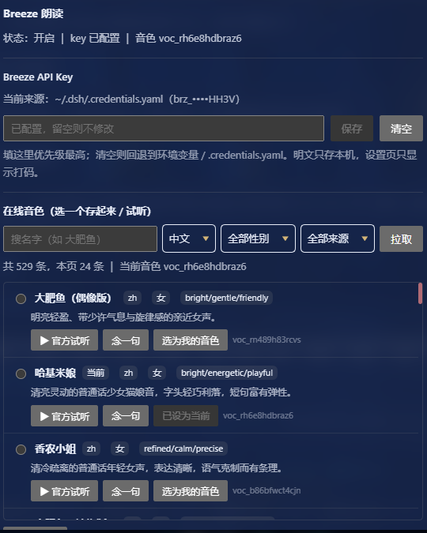

# dsh-breeze-speak

Read each reply aloud with **BreezeBlue / Breeze TTS 2** — starting from the first sentence, roughly 0.6 s after that sentence appears.

一个 DeepSeek Harness 插件：**把每轮回复念出来**，用 BreezeBlue（Breeze TTS 2）。第一句一出现就开始念，约 0.6 秒后出声。



## What it does / 功能

- Hooks the host's `llm/stream` onion middleware, accumulating text as the model emits it.
  挂住宿主 `llm/stream` 洋葱钩子，把模型吐出的文字攒起来。
- **Fires synthesis the moment the first sentence is complete**, instead of waiting for the whole reply — the 0.6–1.3 s of synthesis time hides inside the remaining text generation.
  **第一句一凑齐就立刻发起合成**，不等整条回复写完 —— 那 0.6~1.3 秒的合成时间被藏进后续文字生成里。
- Speaks only the **first sentence** of the reply by default (toggleable), to keep Breeze credits low.
  默认只念**回复开头第一句**（可在配置里关掉），省 Breeze 积分。
- Strips code blocks and `{}` / `[]` / `【】` markers before sending, so they aren't read out as "left brace".
  送给 Breeze 前剥掉代码块 / 花括号 / 方括号标记，免得被逐字念成「左花括号…」。
- Skips model calls initiated by other plugins (e.g. a mood-classifier returning JSON), so you never hear one plugin's JSON read aloud by this one.
  跳过其它插件自己发起的模型调用（如心情判定 JSON），不会串音。
- Streams raw **PCM from Breeze's `/stream` endpoint** and drains it into the browser half, which schedules it on a Web Audio timeline — no waiting for a complete mp3 to be encoded.
  走 Breeze 的 **`/stream` 端点拿 PCM 裸流**，边收边推给网页半边，用 Web Audio 排时间轴连续播（不是等整段 mp3 编完再播）。
- **Enter the Breeze API key in the settings page** — effective immediately, no restart.
  **设置页里能直接填 Breeze API Key**（填完立即生效、不用重启）。
- **Browse online voices**, filter by name / language / gender / origin, paginate, preview, and save one as the default:
  **拉取在线音色**并按名字/语言/性别/来源筛选、分页，**选一个保存为默认音色**，并可试听：
  - "▶ 官方试听" plays Breeze's own preview clip (free, costs no credits);
    「▶ 官方试听」播放 Breeze 自带的预览片段（免费、不花积分）；
  - "念一句" synthesizes one line with that voice (costs a few credits); neither button changes your saved choice.
    「念一句」用该音色现合成一句（消耗少量积分），都不改变已保存的选择。

The settings page exposes the **key** and the **voice picker**. Everything else (`enabled`, `firstSentenceOnly`, `maxChars`, `instructions`) lives in `~/.dsh/breeze-speak.json` and needs a real app restart to take effect.
设置页只放 **key** 和 **音色选择器**；其余字段（`enabled`、`firstSentenceOnly`、`maxChars`、`instructions`）在 `~/.dsh/breeze-speak.json` 里改，需真正重启应用生效。

## Anatomy (a DSH plugin = npm package + host half + web half) / 组成

| File | Role |
| --- | --- |
| `package.json` | declares `dsh.bundle.patch`, `dsh.client`, entry points |
| `cordis.patch.yml` | inserts the plugin into the profile config tree (`id: breeze-speak`) |
| `index.js` | host half: `apply(ctx)`, registers routes, hooks `llm/stream` |
| `client.js` | web half: `window.__ModuleLoader__.load` + settings slot + playback |

## Prerequisites / 前置

1. Node >= 22 (DSH ships its own).
   Node >= 22（DSH 自带）。
2. A BreezeBlue API key (looks like `brz_...`). Any one of three places works:
   一个 BreezeBlue 的 API key（形如 `brz_...`），三种给法任选其一：
   - **Settings page**: open "设置 → Breeze 朗读", paste the key, save (easiest, highest priority);
     设置页：打开「设置 → Breeze 朗读」，把 key 粘进输入框点保存（最方便，优先级最高）；
   - environment variable `BREEZE_API_KEY`;
     环境变量 `BREEZE_API_KEY`；
   - `refs.BREEZE_API_KEY` in `~/.dsh/.credentials.yaml`.
3. The default voice is `voc_u3nxkd5578wc` (an example voice). **Pick one from your own account**:
   open the voice browser → type a name → "拉取" → preview → "选为我的音色".
   音色默认是 `voc_u3nxkd5578wc`（示例音色）。**建议在设置页「在线音色」里挑一个自己账号里可用的**：
   输入名字（比如「大肥鱼」）→ 点「拉取」→ 试听 → 点「选为我的音色」即可。

> Priority: settings page > env var > `.credentials.yaml`. Clicking "清空" in the settings page falls back to the latter two. The key is resolved on every synthesis / voice fetch, so saving it needs no restart.
> 优先级：设置页填写 > 环境变量 > `.credentials.yaml`。
> 设置页里点「清空」就会回退到后两者。key 每次合成 / 拉音色时动态解析，所以保存后**不用重启应用**。

Voice browsing and synthesis both talk to Breeze's cloud API, so they send text and a key to `api.breeze.blue` — nothing else leaves the machine. The key never reaches the browser: the web half only receives PCM frames and a masked tail.
拉音色和合成都要访问 Breeze 云端，也就是把文本和 key 发给 `api.breeze.blue`，此外不发任何东西。key 不下发到浏览器，网页半边只收 PCM 帧和打码后的尾号。

## Config / 配置

`~/.dsh/breeze-speak.json` (absent → defaults; the settings page also writes here when you save a key or voice):
`~/.dsh/breeze-speak.json`（不存在就用默认；设置页保存 key 或音色时也会写这个文件）：

```json
{
  "enabled": true,
  "firstSentenceOnly": true,
  "maxChars": 120,
  "voiceId": "voc_u3nxkd5578wc",
  "instructions": "用傲娇又有点心虚、软软的语气念，句尾轻轻上扬再收回去。",
  "apiKey": ""
}
```

Changing `maxChars` / `instructions` / `firstSentenceOnly` needs a **real app restart** (plugin main code isn't hot-reloaded); changing the key or voice does not.
改字数/语气等要**真正退出桌面应用再重开**（插件主代码不热重载）；但改 key、改音色不用。

## HTTP routes (all under `/dsh-breeze-speak/`) / HTTP 路由

- `GET  /stream` —— SSE, pushes `pcm` frames `{audio(base64), rate, bits, channels}`, then a `pcm-end` frame and `error` frames
- `GET  /state`  —— `{ok, enabled, voiceId, maxChars, keyed, keySource, keyMasked}` (the key is only echoed as a masked tail)
- `POST /config` —— `{apiKey}`, saves/clears the Breeze key (writes `breeze-speak.json`, effective immediately)
- `GET  /voices` —— `?page=1&page_size=24&search=&language_code=&gender=&origin=`, proxies Breeze's voice library;
  returns trimmed `voices[]` + `has_more/total/page/page_size/next_page_token`.
  Measured: Breeze's `page` starts at **1** (0 returns 422), `page_size` accepts at least 100; the only filters that actually apply are
  `search / language_code / gender / origin` (`query / q / name / favorites / mine` are ignored).
- `GET  /preview-url?url=...` —— proxies Breeze's official preview mp3 same-origin (only `https://r.breeze.blue/` links are allowed, SSRF guard)
- `POST /voice` —— `{voiceId}`, saves the selected voice (effective immediately)
- `POST /preview` —— `{text, voiceId?}`, synthesizes one line right away (`voiceId` previews a candidate without changing the saved choice)

Writes are guarded against cross-site requests (`sec-fetch-site` / `Origin` check). The plaintext key stays on the host; the web half only gets audio and a masked string.
写操作带跨站防护（`sec-fetch-site` / `Origin` 校验），明文 key 只在宿主，网页半边只收音频和打码串。

## Why `/stream` (latency, measured) / 为什么用 `/stream`（延迟实测）

Before: the whole reply streams → call the ordinary TTS endpoint (a complete mp3, waiting 2.1–2.8 s) → play with `<audio>`.
The user waited **full-text generation + 2 s** before hearing the first syllable.

现在两处一起改：

1. **Early trigger / 提前触发** — on every text delta from `llm/stream`, check again; as soon as the first sentence (first `。！？；…` or newline) is complete, fire synthesis instead of waiting for `finally`.
2. **`/stream` endpoint + PCM streaming** — first packet arrives in **0.55–1.3 s** (vs 2.1–2.8 s from the whole-mp3 endpoint); push as it arrives and let Web Audio schedule it on a continuous timeline.

Measured (`breeze-tts-2`, 13 Chinese characters):
实测（`breeze-tts-2`、13 字中文）：

| Method | First sound |
| --- | --- |
| Whole-mp3 endpoint (old) | ~2100–2800 ms |
| `/stream` PCM (new) | **~550–1350 ms** |

The PCM stream carries no WAV header; the format was reverse-engineered: the same sentence's mp3 is 3.648 s and the PCM is 172800 bytes
⇒ 47368 B/s ⇒ **24000 Hz / 16 bit / mono** (see `PCM_RATE/PCM_BITS/PCM_CHANNELS` in `index.js`).

注意：`/stream` 端点返回 `content-type: audio/pcm`，别加 `stream`/`speed`/`output_format`/`optimize_latency`
这些 body 字段（会 422 `Extra inputs are not permitted`）；`guidance_scale` 越大首包越快（4.0 约 570 ms，
1.0 约 1270 ms），所以维持 4.0。

### Frame length must be even (the white-noise trap) / 帧长必须对齐到 2 字节（白噪音的坑）

16-bit PCM is 2 bytes per sample, so **every frame's byte count has to be even**. The upstream slices at arbitrary sizes (18 of 36 frames measured were odd).
Decoding each slice independently with `new Int16Array` shifts any frame that lands on an odd byte boundary by one byte (high/low bytes swapped) —
which sounds like a sheet of hissing white noise. Measured: aligned frames jump by ~2600 between samples, misaligned ones by 60000+ (23×).

两边都做了防护：

- **Host** (`flush` in `index.js`): keep the tail for the next frame — `const n = pending.length - (pending.length % 2)` — so every frame that leaves sits on a sample boundary.
  宿主（`index.js` 的 `flush`）：切帧时把尾巴留到下一帧，保证送出去的每一帧都落在样本边界上。
- **Web half** (`takeFrame` in `client.js`): keep a `carry` buffer, prepend last frame's leftover bytes and slice by 2 — no matter how the host cuts it; `stopAll()` clears `carry`.
  网页半边（`client.js` 的 `takeFrame`）：维护一个 `carry` 缓冲，每帧先拼上次剩下的半字节再按 2 字节切，不管宿主怎么切都不会错位；`stopAll()` 时清空 `carry`。

## Install / 安装

From npm (prebuilt, no build step):
从 npm 装（预构建，无构建步骤）：

```bash
dsh plugin --profile <profile> add dsh-breeze-speak
```

Or from the release tarball:
或者从 Release 的 tarball：

```bash
dsh plugin --profile <profile> add https://github.com/rirtue/dsh-breeze-speak/releases/download/v1.0.0/dsh-breeze-speak-1.0.0.tgz
```

Or from a local checkout (don't `add` the directory directly — pnpm may symlink it):
或者从本地源码装（别直接 add 目录 —— pnpm 可能把它当软链）：

```bash
cd dsh-breeze-speak
npm pack                              # → dsh-breeze-speak-1.0.0.tgz
dsh plugin --profile <profile> add ./dsh-breeze-speak-1.0.0.tgz
```

Replace `<profile>` with your profile name (e.g. `desktop`). On Windows the CLI is `dsh.cmd`, usually under the DSH install directory's `resources/runtime/cli/bin/`; use the full path when `dsh` isn't on PATH.
`<profile>` 换成你的 profile 名（例如 `desktop`）。Windows 上 CLI 是 `dsh.cmd`，一般在 DSH 安装目录的 `resources/runtime/cli/bin/` 下；`dsh` 不在 PATH 时就用它的完整路径调用。

The CLI does two things: adds the package name to the profile `package.json`'s `dsh.profile.bundles`, and lays the files into `node_modules/`.
**You don't need to edit the profile's `cordis.patch.yml`** — the bundle's own `cordis.patch.yml` (the `- insert:` entry) is layered in automatically as a bundle layer; the profile layer is only a user override.
CLI 会做两件事：把包名加进 `package.json` 的 `dsh.profile.bundles`、把文件铺到 `node_modules/`。
**不用手改 profile 的 `cordis.patch.yml`** —— bundle 自带的 `cordis.patch.yml`（`- insert:` 那条）会作为 bundle 层自动叠加注册，profile 层只是用户覆盖层。

Measured on dsh 0.2.2-rc.1: this takes effect **hot** — routes are reachable right after install, no restart.
But the "Breeze 朗读" settings section needs a **page refresh** to load the new client bundle.
Changing `index.js` main code still requires fully quitting and reopening the app.
实测在 dsh 0.2.2-rc.1 上是**热生效**的：装完路由立刻可访问，不用重启；
但网页半边的「Breeze 朗读」设置页要**刷新一下页面**才会加载新的 client bundle。
改 `index.js` 主代码仍需真正退出应用再重开。

You can also use the in-app "插件 → 添加插件" with a local path / tarball.
也可以在应用内「插件 → 添加插件」里填本地路径 / tarball，效果一样。

## Design notes / 设计说明（为什么这么写）

- **Doesn't touch the reply content** — wraps the hook in an async generator, yields the original text through, and only reads the opening sentence for speech.
  不改会话内容：钩子包一层 async generator，边读边 `yield` 原文，只在 `finally` 里取开头一句去念。
- **No schemastery** — the profile's `node_modules` doesn't have it, and declaring `Config` makes the plugin fail to load; all config goes through `breeze-speak.json`.
  不引 schemastery：profile 的 `node_modules` 里没有那个包，写 `Config` 会让插件加载失败；配置全走自己的 `breeze-speak.json`。
- **Key never reaches the front end** — the Breeze key is read on the host only; the web half receives PCM frames and a masked string, avoiding cross-site leakage.
  不碰密钥到前端：Breeze key 只在宿主读，网页半边只收音频（PCM 帧）和打码串，避免跨站泄露。
- **Doesn't dump 15k voices on the front end** — server-side filtering + pagination, host returns trimmed fields only; official preview mp3 goes through a same-origin proxy.
  不把 1.5 万条音色灌给前端：服务端筛选 + 分页，宿主只回精简字段；官方预览 mp3 走同源代理。
- **Serial queue** — one sentence finishes before the next is requested: no concurrency, no overlapping audio, no wasted credits.
  串行队列：一句念完再请求下一句，不并发、不叠音、不烧积分。

## License / 许可

MIT
